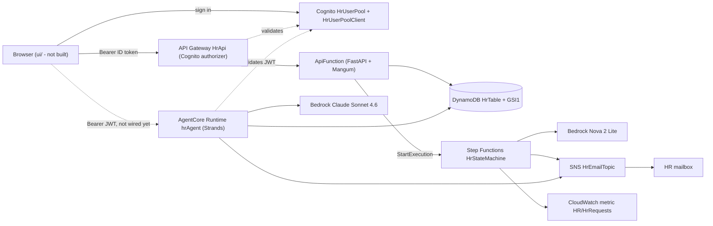
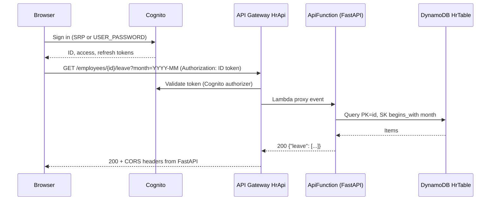
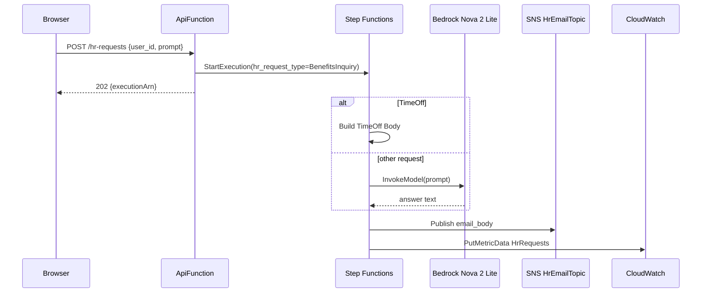
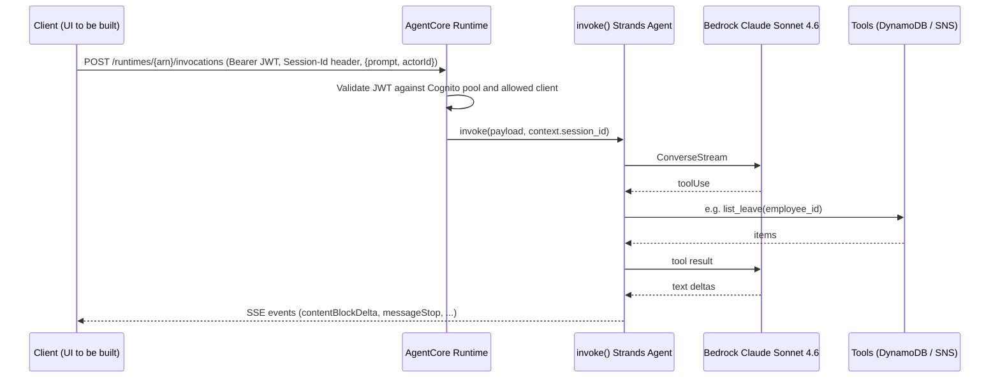

# Architecture - hr-leave-portal

## Architecture Analysis

### System Overview

A serverless AWS application defined in one Python CDK app (`app.py`) with four stacks:

- **HrLeavePortalNotifications** - SNS topic `HrEmailTopic` with one email subscription.
- **HrLeavePortalBackend** - DynamoDB single table `HrTable` (PK/SK + `GSI1`), the FastAPI Lambda `ApiFunction`, API Gateway REST API `HrApi` (Lambda proxy, Cognito authorizer on every method), Cognito `HrUserPool` + `HrUserPoolClient`.
- **HrLeavePortalStateMachine** - Step Functions state machine (JSONata) that routes HR requests to an SNS email (time off) or to Bedrock InvokeModel then SNS (other requests), then emits a CloudWatch metric.
- **HrLeavePortalAgentRuntime** - Bedrock AgentCore Runtime `hrAgent` running the Strands agent container (image URI from SSM), HTTP protocol, Cognito JWT inbound authorizer bound to the backend user pool and client.

A React/Vite SPA exists only as a starter scaffold in `ui/`; no stack hosts it.

### Architectural Style

Serverless, event-assisted. Evidence: Lambda + API Gateway for synchronous CRUD, Step Functions + SNS for asynchronous HR requests, a managed container runtime (AgentCore) for the agent, DynamoDB on-demand. Two independent compute paths (API Lambda and agent) share the same table directly; there is no shared domain library.

### Component Relationships

Text fallback: the browser signs in with Cognito, calls API Gateway with a bearer token; API Gateway validates it against the user pool and proxies to the FastAPI Lambda, which reads/writes DynamoDB and starts Step Functions executions. The state machine calls Bedrock (Nova) for non-time-off requests, publishes to SNS (email to HR) and writes a CloudWatch metric. The AgentCore runtime validates a Cognito JWT, then the Strands agent uses Claude Sonnet 4.6 and its tools read/write the same DynamoDB table and publish to the same SNS topic. The browser-to-agent path does not exist yet.

### Data Flow

- **CRUD**: Browser -> API Gateway (authorizer) -> Lambda -> DynamoDB -> JSON response (synchronous).
- **HR request**: Browser -> API -> Lambda `StartExecution` -> `202 {executionArn}` returned immediately; the state machine continues asynchronously and its only outputs are an SNS email and a metric. Nothing is written back to DynamoDB, and no endpoint reads execution status.
- **Agent chat**: Client -> AgentCore `/invocations` (JWT) -> `invoke(payload, context)` -> Strands `stream_async` -> SSE stream of Bedrock ConverseStream events. Tools act on DynamoDB/SNS with the runtime role, not the caller's identity.
- **Single-table layout** (`HrTable`): employees `PK="USER", SK=<employeeId>, GSI1PK="USER_BY_DATE", GSI1SK=<startDate>`; leave `PK=<employeeId>, SK=<startDate>`.

### Key Design Decisions

1. **One Cognito pool for API and agent** - the AgentCore authorizer (`RuntimeAuthorizerConfiguration.using_cognito(user_pool, [user_pool_client])`) reuses the backend pool/client, so one sign-in can serve both. Consequence: API Gateway's Cognito authorizer (no OAuth scopes) accepts the ID token, while the AgentCore authorizer checks allowed clients, a claim the access token carries (`client_id`); the UI will likely send the ID token to the API and the access token to the agent (to verify in design).
2. **Build artifacts passed through SSM** - Lambda layer ARN and agent image URI are produced by scripts and read at synth time (`value_for_string_parameter`). Consequence: deploy order is scripts first, then `cdk deploy`.
3. **Cross-stack wiring by object passing** - `StateMachineStack` injects `HR_STATE_MACHINE_ARN` and a `states:StartExecution` policy into the Backend Lambda, so `HrLeavePortalBackend` depends on `HrLeavePortalStateMachine` (which depends on Notifications). A UI stack consuming `backend.api`, `backend.user_pool`, `backend.user_pool_client` and the runtime ARN fits this same pattern.
4. **Fire-and-forget HR requests** - simple, but results are not visible to a UI.
5. **Permissive CORS** - FastAPI `CORSMiddleware(allow_origins=["*"])` and API Gateway preflight `ALL_ORIGINS`; no gateway responses add CORS headers to authorizer 401/403 errors.

### Improvement Opportunities

- Add authorization beyond authentication (Cognito groups such as HR vs employee; derive `user_id`/`actorId` from token claims instead of request bodies).
- Expose HR-request status/results (persist outcomes or add `GET /hr-requests/{id}` via `DescribeExecution`).
- Add `GatewayResponse` CORS headers for `DEFAULT_4XX`/`DEFAULT_5XX`; restrict origins to the UI's CloudFront domain once it exists.
- Verify browser CORS support of the AgentCore data plane; if absent, front the agent with a proxy Lambda/API route that also streams.
- Create the AgentCore Memory resource in CDK and pass `MEMORY_AGENTMEMORY_ID`, or drop the memory config.
- Add `CfnOutput`s or SSM parameters for the region and the runtime's invocation URL; register the UI origin as Cognito callback/logout URL if the hosted UI is used.
- Factor the duplicated DynamoDB access code into one shared module.

## Interaction Diagrams

### Authenticated CRUD (e.g. list an employee's leave)

Text fallback: the user signs in to Cognito and receives tokens; the browser calls the API with the token; API Gateway validates it and proxies to FastAPI, which queries DynamoDB and returns the items with CORS headers.

### Asynchronous HR request

Text fallback: the API starts an execution and returns 202 with the execution ARN only; the state machine builds the email body (template for time off, Bedrock answer otherwise), publishes it to SNS and records a metric. The caller never receives the result.

### Agent chat turn

Text fallback: the client posts a prompt with a bearer JWT and a session id header; AgentCore validates the token and calls the `invoke` entrypoint, which streams the Strands agent; the model may call tools that hit DynamoDB or SNS; text deltas stream back to the client as server-sent events. One cached Agent per (session_id, actorId) keeps conversation state in the session's process.
