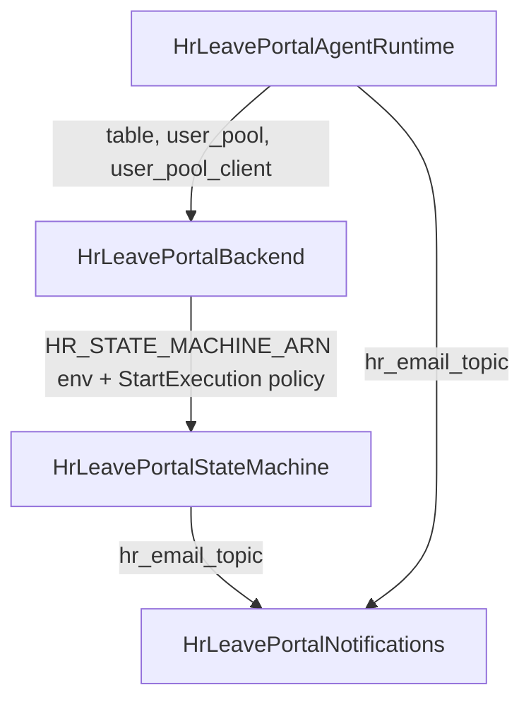

# Dependencies - hr-leave-portal

External library versions are listed once in `technology-stack.md`.

## Internal Dependencies

### CDK stack graph (`app.py`)

Text fallback: StateMachine depends on Notifications (topic ARN). Backend depends on StateMachine because the state machine stack writes its ARN into the backend Lambda's environment and role policy. AgentRuntime depends on Backend (table, user pool, client) and Notifications (topic). A new UI stack would depend on Backend (`api`, `user_pool`, `user_pool_client`) and AgentRuntime (runtime ARN); because Backend already depends on StateMachine, the UI stack must not be referenced back by those stacks (for example by adding its CloudFront domain to the backend's CORS or Cognito callback URLs) without creating a dependency cycle.

### Code-level

| From | To | Kind |
|---|---|---|
| `api/handler.py` | `controllers.*` | import |
| `api/controllers/*` | `models`, `services.*` | import |
| `api/services/employee_service.py`, `leave_service.py` | DynamoDB table via `TABLE_NAME` | runtime |
| `api/services/hr_request_service.py` | Step Functions via `HR_STATE_MACHINE_ARN` | runtime |
| `hrAgent/app/agent/main.py` | `model.load`, `parse`, `memory.session`, `tools.*` | import |
| `hrAgent/app/agent/tools/employee_tools.py`, `leave_tools.py` | same DynamoDB key schema as `api/services/` | duplicated logic, no shared module |
| `state_machine_stack.py` | `state_machines/hr_state_machine_definition.json` | file read at synth (relative path, so `cdk` must run from repo root) |

No circular imports found.

## Build/Deploy-time Dependencies

| Producer | Hand-off | Consumer |
|---|---|---|
| `scripts/build_layer.sh` | SSM `/hr-leave-portal/fastapi-layer-arn` | BackendStack layer |
| `scripts/build_and_push_agent.sh` | ECR `hr-agent:<tag>`, SSM `/hr-leave-portal/agent-image-uri` | AgentRuntimeStack |
| Agent image | public base `public.ecr.aws/docker/library/python:3.12-slim-trixie` | Dockerfile |

## External Service Dependencies

Bedrock model access must be enabled for `us.amazon.nova-2-lite-v1:0` and `global.anthropic.claude-sonnet-4-6`. The SNS email subscription must be confirmed by the recipient. AgentCore Memory (`MEMORY_AGENTMEMORY_ID`) is optional and currently absent.

## Manifest Drift

`requirements.txt` (aws-cdk-lib >=2.273, constructs) and `pyproject.toml` (adds boto3, fastapi, uvicorn; dev group adds mangum) disagree; uv/`pyproject.toml` is the effective manifest. FastAPI/mangum reach Lambda only via the layer, not the asset.
